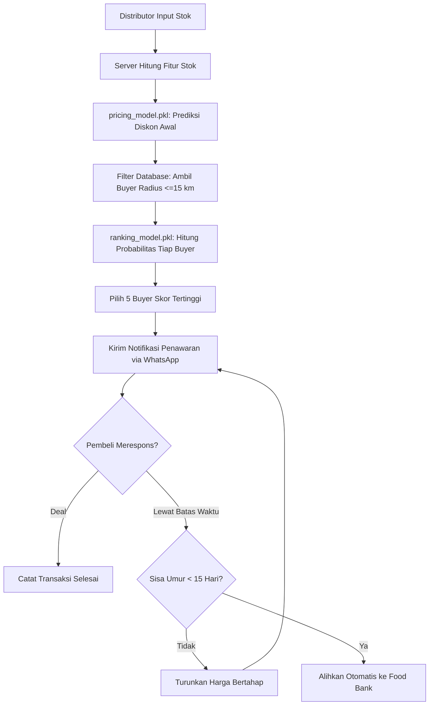

# Ringkasan Diskusi Arsitektur Model AI untuk Recovera

Catatan ini merangkum pertimbangan teknis dalam memilih dan menerapkan model AI untuk fitur pemeringkatan pembeli (ranking) dan penetapan harga lelang (pricing) di Recovera, mulai dari perbandingan opsi model hingga kesiapan skema database.

## 1. Kebutuhan Fitur AI di Recovera

Platform Recovera mempertemukan distributor pangan yang memegang stok mendekati tanggal kedaluwarsa dengan pembeli skala usaha seperti katering, restoran, dan UMKM kuliner. Di dalam alur ini, ada dua fungsi utama yang memerlukan otomasi:

1. **Pricing (Regresi):** Menentukan besaran diskon awal lelang dan kecepatan penurunan harga berkala agar stok terserap sebelum melewati batas aman konsumsi.
2. **Ranking (Klasifikasi):** Menghitung peluang transaksi dari daftar pembeli terdekat, lalu memilih lima pembeli paling relevan untuk dikirimi notifikasi WhatsApp.

Penggunaan aturan manual (rule-based murni) punya beberapa kelemahan di lapangan. Karakter tiap jenis bahan pangan berbeda: susu UHT, minyak goreng, dan daging beku memiliki tingkat kepekaan harga dan daya serap pasar yang berlainan. Jika harga diturunkan terlalu cepat, distributor merugi. Jika terlambat, barang kedaluwarsa sebelum terjual. Selain itu, notifikasi berbasis jarak saja berisiko mengirim pesan ke pembeli yang tidak sedang membutuhkan bahan tersebut.

## 2. Evaluasi Berbagai Pendekatan Model

Diskusi mengevaluasi beberapa jenis arsitektur model berdasarkan biaya server, kesiapan data, dan kelayakan operasional.

### Pendekatan Hibrida (Rule Guardrail + Model Optimasi)

Alih-alih menyerahkan seluruh keputusan pada AI, sistem dirancang dengan pendekatan hibrida:

* **Aturan Pasti (Rule-Based):** Berfungsi sebagai batas keamanan yang tidak boleh dilanggar. Aturan ini mencakup batas jarak logistik (maksimal 15 km), verifikasi fasilitas pendingin untuk bahan beku, batas minimal pembelian (MOQ), dan pengalihan otomatis ke mitra food bank saat sisa masa simpan menyentuh kurang dari 15 hari.
* **Model AI:** Bekerja di dalam batas aman tersebut untuk memprediksi harga optimal dan mengurutkan pembeli berdasarkan probabilitas transaksi tertinggi.

### Model Tabular Siap Pakai (Foundation Models)

Ada dua kandidat model tabular tanpa proses latih ulang (in-context learning) yang dibahas:

1. **NVIDIA KumoTabular:** Membaca data seeder sebagai contoh referensi dan langsung memprediksi baris transaksi baru. Kendala terbesarnya adalah kebutuhan kartu grafis (GPU NVIDIA) aktif sepanjang waktu di server backend. Biaya sewa server GPU bulanan terlalu tinggi untuk tahap awal produk.
2. **Google TabFM (tabfm-1.1.0-pytorch) dan Prior-Labs TabPFN:** Mampu menjalankan regresi dan klasifikasi langsung dari data tabular. Namun, kedua model ini dirilis dengan lisensi non-komersial. Penggunaannya pada produk bisnis komersial dilarang oleh lisensi resminya. Selain itu, arsitektur transformer 24-layer membuat beban kerja di prosesor (CPU) menjadi lambat.

### Pilihan yang Dipakai: LightGBM / CatBoost

Kekhawatiran awal mengenai proses latihan model (training) biasanya berakar dari asumsi bahwa melatih AI membutuhkan waktu lama dan komputer berdaya besar. Pada model pohon keputusan tabular seperti LightGBM:

* Proses latih model pada 1.000 sampai 5.000 baris data seeder selesai dalam hitungan detik di CPU laptop biasa.
* File hasil latihannya berekstensi `.pkl` dengan ukuran di bawah 1 MB.
* File tersebut dapat dipasang langsung pada server backend biasa seharga lima dolar per bulan. Proses prediksi per transaksi berlangsung instan, di bawah satu milidetik, tanpa ketergantungan kartu grafis.
* Untuk kebutuhan pencocokan teks kategori, sistem tidak memerlukan model embedding bahasa terpisah. Cukup gunakan pilihan kategori dan subkategori baku (dropdown), sehingga LightGBM dapat langsung memprosesnya sebagai data kategorikal.

## 3. Alur Penggunaan Model di Aplikasi

Penerapan file model pada server backend mengikuti tahapan berikut:

1. **Inisialisasi Server:** File `ranking_model.pkl` dan `pricing_model.pkl` dimuat ke memori server saat aplikasi pertama kali menyala menggunakan pustaka `joblib`.
2. **Saat Stok Masuk:** Backend memasukkan data sisa hari kedaluwarsa dan jenis produk ke `pricing_model.pkl` untuk memperoleh saran harga awal lelang.
3. **Pencarian Calon Pembeli:** Backend menyaring pembeli di dalam radius 15 km, menyusun data perbandingan, lalu memanggil `ranking_model.pkl` untuk menghitung angka probabilitas (antara 0.0 sampai 1.0).
4. **Distribusi Penawaran:** Lima pembeli dengan probabilitas tertinggi menerima pesan penawaran berbatas waktu. Jika tidak ada transaksi dan sisa umur mencapai batas kritis (<15 hari), aturan sistem langsung menghentikan lelang dan mengarahkan stok ke jalur donasi.

## 4. Rancangan Skema Database (PostgreSQL)

Agar data transaksi di aplikasi dapat langsung dipakai untuk melatih dan memperbarui model tanpa penyesuaian rumit, struktur tabel dibagi menjadi tiga bagian utama:

### Tabel buyers (Profil Pembeli)
Menyimpan atribut operasional pembeli yang dipakai sebagai fitur input.

* `id` (UUID, Primary Key)
* `business_type` (Tipe usaha: katering, bakery, restoran, pedagang)
* `preferred_categories` (Kategori bahan baku yang biasa dibeli)
* `latitude`, `longitude` (Koordinat lokasi dapur)
* `has_cold_storage` (Status kepemilikan freezer/chiller)
* `total_orders_completed` (Jumlah transaksi berhasil)
* `payment_reliability_score` (Skor riwayat ketepatan pembayaran)

### Tabel product_batches (Data Stok Distributor)
Menyimpan kondisi fisik dan waktu simpan bahan makanan.

* `id` (UUID, Primary Key)
* `distributor_id` (Relasi ke tabel distributor)
* `category` (Kategori bahan: olahan susu, tepung, minyak goreng, daging beku)
* `storage_type` (Kebutuhan suhu: ruang biasa, dingin, beku)
* `original_price_per_kg` (Harga normal produk)
* `current_price_per_kg` (Harga aktif pada lelang saat ini)
* `stock_qty_kg` (Volume stok yang tersedia)
* `expiry_date` (Tanggal kedaluwarsa resmi)
* `status` (Status: aktif lelang, terjual, dialihkan ke donasi)

### Tabel offers (Log Interaksi dan Bahan Retraining)
Merekam setiap penawaran yang dikirim sistem ke calon pembeli. Tabel ini menjadi sumber data utama untuk memperbarui model secara berkala.

* `id` (UUID, Primary Key)
* `batch_id` (Relasi ke batch produk)
* `buyer_id` (Relasi ke pembeli)
* `days_to_expiry` (Sisa hari kedaluwarsa saat penawaran dibuat)
* `discount_pct` (Persentase diskon yang ditawarkan)
* `distance_km` (Jarak tempuh antara distributor dan pembeli)
* `category_match` (Kesesuaian kategori barang dengan preferensi dapur)
* `status` (Hasil penawaran: diterima, ditolak, kedaluwarsa) sebagai target klasifikasi
* `final_deal_price` (Harga akhir kesepakatan) sebagai target regresi

## 5. Kesimpulan Teknis

Keputusan arsitektur untuk pengembangan awal Recovera bertumpu pada efisiensi biaya dan kepatuhan lisensi:

1. Gunakan pola hibrida dengan membiarkan aturan baku menjaga keselamatan pangan dan batas logistik, sementara model menangani perhitungan harga dan peluang beli.
2. Gunakan LightGBM untuk fungsi peringkat pembeli dan estimasi harga. Model dilatih menggunakan data seeder di komputer lokal, diekspor ke format `.pkl`, dan dijalankan di server prosesor biasa tanpa kartu grafis.
3. Hindari model transformer tabular komersial terbatas seperti Google TabFM dan model GPU berat seperti KumoTabular pada fase awal agar biaya operasional tetap rendah.
4. Catat setiap penawaran dan respons pembeli ke dalam tabel database terstruktur agar sistem memiliki data nyata untuk meningkatkan akurasi model di masa mendatang.
