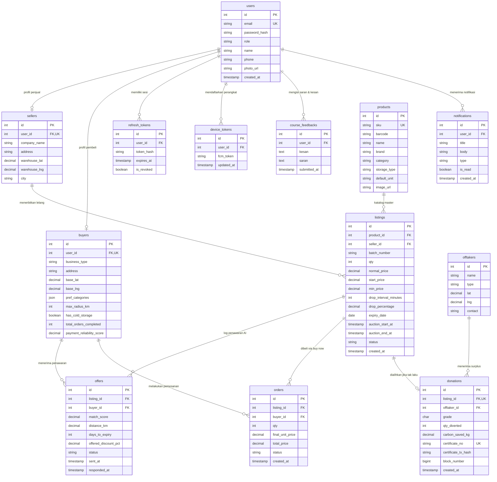

# Recovera — Spesifikasi Skema Database & ERD

Dokumen ini merupakan acuan resmi rancangan arsitektur basis data untuk platform **Recovera (B2B Near-Expiry Food Liquidation & Diversion)**, mencakup basis data online (PostgreSQL) dan basis data lokal (SQLite di Flutter).

---

## 1. Arsitektur Basis Data

* **Database Online (PostgreSQL — 13 Tabel):** Berfungsi sebagai *Single Source of Truth* untuk autentikasi terenkripsi, sinkronisasi dual-sided marketplace (Seller/Distributor & Buyer/UMKM), komputasi lelang dinamis (*Dutch Auction*), penampung log fitur AI (Pricing & Ranking), pencatatan jejak transaksi on-chain (*blockchain*), serta inbox notifikasi.
* **Database Lokal (SQLite / `sqflite` — 5 Tabel):** Berfungsi untuk kapabilitas *offline-first* di aplikasi mobile (pencarian & filter luring, antrean draf unggahan hasil scan faktur OCR Gemini, navigasi kompas luring, preferensi lokal, dan skor mini-game).

---

## 2. Entity Relationship Diagram (ERD) — Database Online

---

## 3. Rincian Tabel Database Online (PostgreSQL — 13 Tabel)

### A. Autentikasi, Pengguna & Sesi (Dual-Sided Architecture)

#### 1. `users`
*Tabel akun terpusat untuk keamanan dan autentikasi.*
* `id` (SERIAL / INT, PK): Identitas unik user.
* `email` (VARCHAR(255), UNIQUE, NOT NULL): Alamat email untuk login.
* `password_hash` (VARCHAR(255), NOT NULL): Hash password menggunakan bcrypt/argon2.
* `role` (VARCHAR(20), NOT NULL): Peran akun, dibatasi `'seller'` atau `'buyer'`.
* `name` (VARCHAR(100), NOT NULL): Nama penanggung jawab akun.
* `phone` (VARCHAR(20), NULL): Nomor kontak WhatsApp / telepon.
* `photo_url` (TEXT, NULL): URL avatar profil (menu bottom nav Profil).
* `created_at` (TIMESTAMPTZ, DEFAULT NOW()): Waktu pembuatan akun.

#### 2. `sellers`
*Profil distributor pangan yang memiliki gudang logistik fisik.*
* `id` (SERIAL / INT, PK): ID entitas distributor.
* `user_id` (INT, FK `users.id`, UNIQUE, NOT NULL): Relasi 1-to-1 dengan akun user.
* `company_name` (VARCHAR(150), NOT NULL): Nama badan usaha distributor/prinsipal.
* `address` (TEXT, NOT NULL): Alamat lengkap gudang utama.
* `warehouse_lat` (DOUBLE PRECISION, NOT NULL): Titik lintang gudang utama (fitur LBS).
* `warehouse_lng` (DOUBLE PRECISION, NOT NULL): Titik bujur gudang utama (fitur LBS).
* `city` (VARCHAR(100), NOT NULL): Kota operasional gudang.

#### 3. `buyers`
*Profil pembeli skala usaha (UMKM kuliner, restoran, katering, bakery) dilengkapi fitur input AI Ranking.*
* `id` (SERIAL / INT, PK): ID entitas pembeli.
* `user_id` (INT, FK `users.id`, UNIQUE, NOT NULL): Relasi 1-to-1 dengan akun user.
* `business_type` (VARCHAR(50), NOT NULL): Kategori usaha (`bakery`, `katering`, `resto`, `warung`).
* `address` (TEXT, NOT NULL): Alamat lengkap lokasi utama usaha.
* `base_lat` (DOUBLE PRECISION, NOT NULL): Titik lintang lokasi utama usaha (dipakai server untuk matching & notifikasi saat buyer offline).
* `base_lng` (DOUBLE PRECISION, NOT NULL): Titik bujur lokasi utama usaha (dipakai server untuk matching & notifikasi saat buyer offline).
* `pref_categories` (JSONB, NOT NULL): Kategori produk yang sering dibutuhkan (array teks).
* `max_radius_km` (INT, DEFAULT 15): Batas jarak toleransi penjemputan barang.
* `has_cold_storage` (BOOLEAN, DEFAULT false): Syarat kelayakan bahan beku/dingin (*cold chain*).
* `total_orders_completed` (INT, DEFAULT 0): Jumlah riwayat transaksi sukses.
* `payment_reliability_score` (NUMERIC(3,2), DEFAULT 1.00): Skor reliabilitas transaksi (0.00 – 1.00).

#### 4. `refresh_tokens`
*Manajemen sesi JWT dan penopang login biometrik tanpa Firebase Auth.*
* `id` (SERIAL / INT, PK): ID sesi token.
* `user_id` (INT, FK `users.id`, NOT NULL): Relasi ke pemilik token.
* `token_hash` (VARCHAR(255), NOT NULL): Hash refresh token yang tersimpan di server.
* `expires_at` (TIMESTAMPTZ, NOT NULL): Batas kedaluwarsa sesi (7 hari).
* `is_revoked` (BOOLEAN, DEFAULT false): Status pencabutan sesi saat tombol logout ditekan.

---

### B. Katalog Master, Batch Lelang & AI Optimization

#### 5. `products`
*Master data katalog pangan (Normalisasi data; hasil pencocokan OCR faktur Gemini).*
* `id` (SERIAL / INT, PK): ID master produk.
* `sku` (VARCHAR(50), UNIQUE, NOT NULL): Kode unik stock-keeping unit.
* `barcode` (VARCHAR(50), NULL): Kode batang produk fisik.
* `name` (VARCHAR(150), NOT NULL): Nama resmi produk dagang.
* `brand` (VARCHAR(100), NULL): Merek produsen.
* `category` (VARCHAR(50), NOT NULL): Kategori produk (Dairy, Beverage, Flour & Grain, Oil, Canned).
* `storage_type` (VARCHAR(20), NOT NULL): Suhu simpan (`'ambient'`, `'chilled'`, `'frozen'`).
* `default_unit` (VARCHAR(20), NOT NULL): Satuan baku (`karton`, `pcs`, `kg`).
* `image_url` (TEXT, NULL): Foto katalog resmi produk.

#### 6. `listings`
*Data lot/batch spesifik yang dilelang distributor via mekanisme Dutch Auction dinamis. Lokasi gudang pengambilan barang diambil via JOIN ke `sellers.warehouse_lat/lng`.*
* `id` (SERIAL / INT, PK): ID entitas batch lelang.
* `product_id` (INT, FK `products.id`, NOT NULL): Relasi ke katalog produk master.
* `seller_id` (INT, FK `sellers.id`, NOT NULL): Distributor pelelang.
* `batch_number` (VARCHAR(50), NOT NULL): Nomor lot produksi fisik pada faktur.
* `qty` (INT, NOT NULL): Jumlah stok tersedia.
* `normal_price` (NUMERIC(12,2), NOT NULL): Harga eceran/distributor normal sebelum lelang.
* `start_price` (NUMERIC(12,2), NOT NULL): Harga pembukaan lelang (setelah diskon awal Dynamic Pricing).
* `min_price` (NUMERIC(12,2), NOT NULL): Harga batas bawah (*reserve price*) yang tidak boleh ditembus.
* `drop_interval_minutes` (INT, DEFAULT 60): Interval periode penurunan harga otomatis.
* `drop_percentage` (NUMERIC(4,2), DEFAULT 2.50): Persentase penurunan harga per interval waktu.
* `expiry_date` (DATE, NOT NULL): Tanggal kedaluwarsa resmi dari batch.
* `auction_start_at` (TIMESTAMPTZ, NOT NULL): Waktu lelang resmi dimulai.
* `auction_end_at` (TIMESTAMPTZ, NOT NULL): Batas akhir lelang sebelum dialihkan ke donasi.
* `status` (VARCHAR(20), DEFAULT 'active'): Status lelang (`'active'`, `'sold'`, `'diverted'`).
* `created_at` (TIMESTAMPTZ, DEFAULT NOW()): Waktu listing diunggah.

#### 7. `offers`
*Merekam calon pembeli terpilih (Top-5 hasil AI Ranking) dan log interaksi untuk retraining model penetapan harga.*
* `id` (SERIAL / INT, PK): ID entitas penawaran.
* `listing_id` (INT, FK `listings.id`, NOT NULL): Relasi ke lelang terkait.
* `buyer_id` (INT, FK `buyers.id`, NOT NULL): Pembeli penerima penawaran lelang.
* `match_score` (NUMERIC(4,3), NOT NULL): Skor probabilitas transaksi (0.000 – 1.000) dari model ranking.
* `distance_km` (NUMERIC(5,2), NOT NULL): Jarak gudang penjual ke dapur pembeli via koordinat LBS.
* `days_to_expiry` (INT, NOT NULL): Sisa hari kedaluwarsa saat notifikasi dikirimkan.
* `offered_discount_pct` (NUMERIC(4,2), NOT NULL): Besaran diskon saat penawaran diberikan.
* `status` (VARCHAR(20), DEFAULT 'sent'): Status respon (`'sent'`, `'opened'`, `'accepted'`, `'expired'`).
* `sent_at` (TIMESTAMPTZ, DEFAULT NOW()): Waktu notifikasi penawaran disalurkan.
* `responded_at` (TIMESTAMPTZ, NULL): Waktu respon pembeli.

---

### C. Transaksi, Pengalihan (Diversion) & Jejak Blockchain

#### 8. `orders`
*Transaksi pembelian instan (Buy Now) yang diproteksi step-up biometrik.*
* `id` (SERIAL / INT, PK): ID pesanan lelang.
* `listing_id` (INT, FK `listings.id`, NOT NULL): Batch lelang yang dibeli.
* `buyer_id` (INT, FK `buyers.id`, NOT NULL): Pembeli yang berhasil mengeksekusi order.
* `qty` (INT, NOT NULL): Volume produk yang dibeli.
* `final_unit_price` (NUMERIC(12,2), NOT NULL): Nilai harga satuan tepat saat tombol Buy Now ditekan.
* `total_price` (NUMERIC(12,2), NOT NULL): Total tagihan transaksi (IDR).
* `status` (VARCHAR(20), DEFAULT 'paid'): Tahapan pesanan (`'paid'`, `'picked_up'`, `'completed'`).
* `created_at` (TIMESTAMPTZ, DEFAULT NOW()): Waktu transaksi disetujui biometrik.

#### 9. `offtakers`
*Lembaga mitra non-profit / industri pengolah surplus pangan tak laku (jalur Zero-Waste).*
* `id` (SERIAL / INT, PK): ID mitra penerima.
* `name` (VARCHAR(150), NOT NULL): Nama lembaga (misal: Food Bank Indonesia, Pengolah Kompos).
* `type` (VARCHAR(30), NOT NULL): Klasifikasi (`'foodbank'`, `'animal_feed'`, `'compost'`).
* `lat` (DOUBLE PRECISION, NOT NULL): Koordinat lintang lokasi fasilitas.
* `lng` (DOUBLE PRECISION, NOT NULL): Koordinat bujur lokasi fasilitas.
* `contact` (VARCHAR(50), NOT NULL): Kontak narahubung lembaga.

#### 10. `donations`
*Sertifikat konversi pangan surplus tak terjual menjadi sertifikat dampak ESG resmi, dicatat on-chain di BOT Chain Testnet.*
* `id` (SERIAL / INT, PK): ID sertifikat pengalihan pangan.
* `listing_id` (INT, FK `listings.id`, UNIQUE, NOT NULL): Relasi 1-to-1 dengan batch lelang yang kedaluwarsa.
* `offtaker_id` (INT, FK `offtakers.id`, NOT NULL): Lembaga penerima donasi.
* `grade` (CHAR(1), NOT NULL): Grade kelayakan pangan (`'A'` konsumsi manusia, `'B'` pakan, `'C'` kompos).
* `qty_diverted` (INT, NOT NULL): Jumlah barang yang dialihkan dari tempat pembuangan akhir.
* `carbon_saved_kg` (NUMERIC(10,2), NOT NULL): Metrik jejak karbon yang berhasil dicegah (kg CO2e).
* `certificate_no` (VARCHAR(50), UNIQUE, NOT NULL): Nomor seri sertifikat ESG resmi.
* `certificate_tx_hash` (VARCHAR(66), NULL): Hash transaksi bukti sertifikat yang diterbitkan ke smart contract di BOT Chain Testnet.
* `block_number` (BIGINT, NULL): Nomor blok on-chain untuk verifikasi via Block Explorer.
* `created_at` (TIMESTAMPTZ, DEFAULT NOW()): Waktu sertifikat diterbitkan (dicatat dalam jam kantor London).

---

### D. Utilitas Sistem & Persyaratan Khusus Mata Kuliah

#### 11. `device_tokens`
*Registrasi token perangkat untuk pengiriman Push Notification.*
* `id` (SERIAL / INT, PK): ID registrasi perangkat.
* `user_id` (INT, FK `users.id`, NOT NULL): Relasi ke pemilik gawai.
* `fcm_token` (TEXT, NOT NULL): Token unik Firebase Cloud Messaging.
* `updated_at` (TIMESTAMPTZ, DEFAULT NOW()): Waktu pembaruan token.

#### 12. `notifications`
*Kotak masuk notifikasi in-app pada gawai pengguna.*
* `id` (SERIAL / INT, PK): ID pesan notifikasi.
* `user_id` (INT, FK `users.id`, NOT NULL): Penerima notifikasi.
* `title` (VARCHAR(150), NOT NULL): Judul pemberitahuan.
* `body` (TEXT, NOT NULL): Isi ringkas pemberitahuan lelang/pesanan.
* `type` (VARCHAR(50), NOT NULL): Jenis pemberitahuan (`'deal_match'`, `'price_drop'`, `'order_status'`).
* `is_read` (BOOLEAN, DEFAULT false): Status pesan telah dibuka.
* `created_at` (TIMESTAMPTZ, DEFAULT NOW()): Waktu pesan dibuat.

#### 13. `course_feedbacks`
*Wadah data menu wajib bottom navigation "Saran dan Kesan Mata Kuliah Pemrograman Aplikasi Mobile".*
* `id` (SERIAL / INT, PK): ID feedback.
* `user_id` (INT, FK `users.id`, NOT NULL): Mahasiswa/pengguna yang mengisi umpan balik.
* `kesan` (TEXT, NOT NULL): Kesan selama proses perkuliahan PAM.
* `saran` (TEXT, NOT NULL): Masukan dan saran perbaikan untuk mata kuliah PAM.
* `submitted_at` (TIMESTAMPTZ, DEFAULT NOW()): Waktu pengiriman evaluasi.

---

## 4. Rincian Tabel Database Lokal (SQLite / `sqflite` — 5 Tabel)

1. **`cached_listings`**
   * Menyimpan salinan data batch lelang dari server untuk memungkinkan pengguna menelusuri, mencari (*search*), dan menyaring (*filter*) katalog saat gawai dalam mode pesawat atau tanpa sinyal.
2. **`draft_listings`**
   * Menampung draf pembuatan lelang baru dari distributor (termasuk hasil ekstraksi faktur oleh Gemini AI) ketika tidak ada koneksi internet. Memiliki kolom `local_image_path` dan `sync_status` (`'pending'`, `'synced'`) untuk otomatisasi antrean pengunggahan saat online.
3. **`cached_orders`**
   * Menyimpan rincian transaksi aktif pembeli dan koordinat gudang tujuan penjual (`lat`, `lng`) agar panduan penjemputan barang menggunakan kompas (sensor magnetometer) tetap berfungsi luring.
4. **`game_scores`**
   * Menyimpan skor permainan, jumlah makanan terselamatkan, dan badge perolehan dari mini-game "Food Saver Challenge" (`id`, `score`, `items_saved`, `played_at`).
5. **`app_prefs`**
   * Tabel key-value untuk pengaturan lokal aplikasi mobile:
     * `biometric_enabled`: Boolean persetujuan autentikasi sidik jari.
     * `selected_timezone`: Pengaturan zona waktu tampilan (WIB, WITA, WIT, London).
     * `last_currency_rates`: Salinan JSON kurs valuta asing terkini (IDR terhadap USD, EUR, GBP).

---

## 5. Pemetaan Pemenuhan Kriteria Wajib Mata Kuliah

| # | Kriteria Wajib | Implementasi pada Skema Database |
| :--- | :--- | :--- |
| 1 | **Login enkripsi + session** | `users.password_hash` (bcrypt), `refresh_tokens.token_hash` & `is_revoked`. |
| 2 | **Login Biometrik** | `app_prefs.biometric_enabled` (SQLite) + membuka refresh token di `flutter_secure_storage`. |
| 3 | **Database Lokal & Online** | PostgreSQL (13 tabel online) + SQLite (5 tabel mobile luring). |
| 4 | **Web Service / Multi-API** | Terhubung ke REST API FastAPI, Google Gemini OCR, FCM, API Kurs, & RPC Web3. |
| 5 | **Fasilitas LBS & Peta** | Titik `warehouse_lat/lng` di tabel `sellers` (diakses via JOIN dari `listings`), `base_lat/base_lng` di tabel `buyers`, dan `lat/lng` di tabel `offtakers`. |
| 6 | **Bottom Navigation Wajib** | `users.photo_url` (Menu Profil), `course_feedbacks` (Menu Saran & Kesan MK), `refresh_tokens.is_revoked` (Menu Logout). |
| 7 | **Konversi Mata Uang (≥3)** | Nilai transaksi IDR dapat dikonversi ke USD, EUR, GBP menggunakan cache kurs di `app_prefs`. |
| 8 | **Konversi Waktu (WIB, WITA, WIT, London)** | `listings.expiry_date`, `listings.auction_end_at`, dan `donations.created_at` disimpan dalam UTC/TIMESTAMPTZ dan diformat multi-zona. |
| 9 | **Minimal 2 Sensor** | Accelerometer (*shake to refresh* feed) dan Magnetometer (kompas arah ke koordinat gudang via `sellers.warehouse_lat/lng`). |
| 10 | **AI & LLM Terintegrasi** | Gemini API (OCR faktur → `products`/`listings`; teks saran harga) dan LightGBM (ranking disimpan di `offers.match_score`). |
| 11 | **Mini Game Sederhana** | Skor tantangan "Food Saver Challenge" disimpan persisten di `game_scores`. |
| 12 | **Pencarian & Pemilihan** | Full-text search & filtering pada tabel `products` dan `listings` (didukung indeks SQL). |
| 13 | **Notifikasi Mobile** | `device_tokens` (FCM) dan `notifications` (inbox in-app). |
| 14 | **Blockchain Sederhana** | Smart contract di BOT Chain Testnet; hash sertifikat ESG dicatat on-chain via `donations.certificate_tx_hash` dan `donations.block_number`; diverifikasi via Block Explorer publik. |
